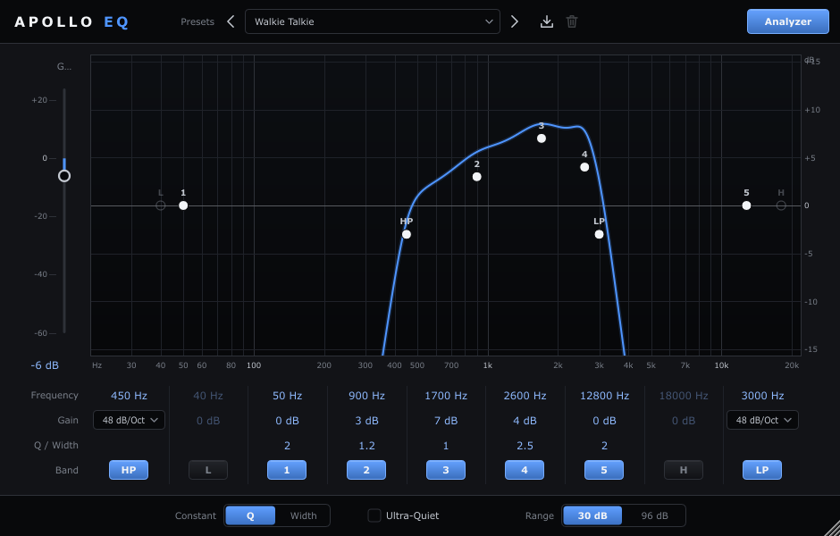

# Apollo EQ

A 9-band parametric equalizer modelled on Adobe Audition's Parametric Equalizer, built with JUCE 8.
It ships as a VST3 / Standalone plugin and as a **JUCE module** you can compile straight into your own
DAW or host.



## Features

- **Bands:** high-pass and low-pass (6–48 dB/oct Butterworth), low and high shelf, five bells.
- **Graph:** a live response curve with draggable nodes over a real-time output spectrum.
- **Controls:**
  - Frequency / Gain / Q-Width / Band grid under the graph, like Audition's.
  - Output gain.
  - *Constant Q* or *Width* (octaves) display.
  - **Ultra-Quiet**: runs the filters at 2x the sample rate for an accurate top end, at the cost of a few samples of reported latency.
  - **30 / 96 dB** graph range.
- **DSP:**
  - Double-precision trapezoidal SVF filters.
  - Every parameter glides per sample (~15 ms), so automation doesn't click.
  - Output doesn't depend on block size; the tests use Audition's alternating 1024/4-sample blocks.
- **Presets:**
  - Factory: (Default), Vocal Enhancer, Walkie Talkie, Muffled (Through a Wall), Clarity (Fix Muffled Voice), Telephone, Podcast Voice, De-Mud, Bass Boost, Air & Presence, Remove Rumble.
  - User presets are saved to `%APPDATA%\Apollo EQ\Presets` (`~/Library/Application Support/Apollo EQ/Presets` on macOS).

### Mouse and keyboard

| Where | Action | Result |
|---|---|---|
| Graph node | Drag | Frequency + gain (Shift = fine) |
| Graph node | Wheel | Q (bells) or slope (HP/LP) |
| Graph node | Double-click | Gain to 0 dB (pass filters: switch off) |
| Graph node | Right-click | Enable, slope, reset |
| Empty graph | Double-click | Places the next unused bell there |
| Value box | Drag up/down | Change (Shift = fine) |
| Value box | Click | Type a value (`1.2k`, `-3`, `0.5 oct` all work) |
| Value box | Ctrl/Alt-click | Reset to default |

## Using it inside your own DAW / host (JUCE)

The `apollo_eq` module holds everything: processor, editor, presets and DSP. Your project already
brings JUCE, and Apollo EQ reuses that copy; it only fetches its own JUCE when it's the top-level project.

### 1. Add it with CMake

```cmake
include(FetchContent)

# ... your JUCE (8.x) is already added before this point ...

FetchContent_Declare(ApolloEQ
    GIT_REPOSITORY https://github.com/ghostspectrogram/apollo-eq.git
    GIT_TAG        v1.0.0)
FetchContent_MakeAvailable(ApolloEQ)        # or: add_subdirectory(external/apollo-eq)

target_link_libraries(MyDaw PRIVATE Apollo::apollo_eq)
```

Added as a subproject it builds nothing extra (no plugin, no tests) and leaves your JUCE untouched.
Your target needs C++20.

Projucer users: add `modules/apollo_eq` as a module path instead.

### 2. Run it

```cpp
#include <apollo_eq/apollo_eq.h>

// As a node in an AudioProcessorGraph (per track / bus / master):
auto node = graph.addNode (std::make_unique<apollo::ApolloProcessor>());

// Or own it directly:
apollo::ApolloProcessor eq;
eq.setPlayConfigDetails (2, 2, sampleRate, blockSize);   // mono or stereo, in == out
eq.prepareToPlay (sampleRate, blockSize);
eq.processBlock (buffer, midi);                          // any block size up to and beyond blockSize is fine
eq.getLatencySamples();                                  // non-zero only while Ultra-Quiet is on: compensate in your mixer

// UI: the processor's own editor
std::unique_ptr<juce::AudioProcessorEditor> ui (eq.createEditor());   // delete before the processor
```

`examples/EmbeddedHost` is a complete, buildable host: audio in → Apollo EQ → audio out, in an
`AudioProcessorGraph`, with the editor in a window.

### 3. Control it from your DAW

All parameters live in `eq.apvts` (an `AudioProcessorValueTreeState`), so your automation lanes,
undo and so on can drive them like any plugin parameter (`eq.getParameters()`).

| Parameter ID | Range | Notes |
|---|---|---|
| `hp_on`, `ls_on`, `b1_on` … `b5_on`, `hs_on`, `lp_on` | bool | band enable |
| `<band>_freq` | 20 – 22000 Hz (log) | all bands |
| `ls_gain`, `b1_gain` … `b5_gain`, `hs_gain` | ±48 dB | shelves + bells |
| `b1_q` … `b5_q` | 0.1 – 40 (log) | bells |
| `hp_slope`, `lp_slope` | choice 0–7 | 6, 12 … 48 dB/oct |
| `master` | −60 … +24 dB | output gain |
| `ultra_quiet` | bool | 2x oversampled filtering |
| `constant_width`, `range_96`, `analyser` | bool | display only |

C++ helpers: `apollo::ids::freq (band::b3)` → `"b3_freq"`, and `apollo::bandSpecs` describes each
band (label, type, defaults).

```cpp
eq.presets.loadFactory (2);                       // index into apollo::factoryPresets() — 2 = Walkie Talkie
eq.presets.saveUser ("My Vocal");  eq.presets.loadUser ("My Vocal");
eq.getStateInformation (block);    eq.setStateInformation (data, size);   // project save / load
```

### 4. Drawing your own UI instead (optional)

If your DAW draws its own EQ widgets (a mini curve in the mixer strip, say), use the same maths the
editor uses. It is exact: the tests check it against the processed audio to within 0.001 dB.

```cpp
apollo::dsp::BandSettings s { 291.0 /*Hz*/, -3.0 /*dB*/, 1.5 /*Q*/ };
double db = apollo::dsp::magnitudeDb (apollo::BandType::peak, s, frequency, sampleRate);
```

`apollo::dsp::BandFilter` is also usable on its own as a per-band filter (`configure`, `process`, `reset`).
The output spectrum for an analyser display is in `eq.analyser`: set `analyser.active = true` and
`pull()` samples from the message thread.

### Threading

- `processBlock` is real-time safe: no locks or allocation after `prepareToPlay`.
- Parameters are atomics.
- Presets, state and the editor belong on the message thread.

## Building the plugin

Requirements: CMake ≥ 3.22, a C++20 compiler (Visual Studio 2022 on Windows), git.

```powershell
cmake -B build -G "Visual Studio 17 2022" -A x64          # add -DFETCHCONTENT_SOURCE_DIR_JUCE=C:/path/to/JUCE to reuse a local JUCE
cmake --build build --config Release
build\ApolloTests_artefacts\Release\ApolloTests.exe       # or: ctest --test-dir build -C Release
```

Outputs:

- `build/ApolloEQ_artefacts/Release/VST3/Apollo EQ.vst3`: copy it to `C:\Program Files\Common Files\VST3`.
- `build/ApolloEQ_artefacts/Release/Standalone/Apollo EQ.exe`.

The MSVC runtime is linked statically, so no redistributable is needed.

Prebuilt Windows binaries are attached to each [release](https://github.com/ghostspectrogram/apollo-eq/releases).

## Notes for Adobe Audition (and other hosts)

- **GPU crash fix.** As the top-level project, `cmake/PatchJuce.cmake` patches the JUCE checkout at configure time so the plugin renders on the CPU. JUCE's Direct2D/Direct3D path crashed Audition inside the NVIDIA driver.
  - The patch only takes effect with `JUCE_GHOST_NO_GPU=1`.
  - To use it in your own project, set `-DAPOLLO_EQ_PATCH_JUCE=ON` and `JUCE_SOURCE_DIR`.
- **Block sizes.** Audition alternates 1024- and 4-sample blocks and only runs effects while its transport plays. Apollo EQ handles both.
- **Presets.** The plugin exposes a single host program. Presets live in its own browser, so hosts that call `setCurrentProgram (0)` on load can't overwrite a restored session.

## Layout

```
modules/apollo_eq/            the JUCE module (everything a host needs)
  apollo_eq.h / .cpp          module header + unity build
  Source/Params.h             band layout, parameter IDs, formatting
  Source/EqDsp.h              filters + exact magnitude response
  Source/Presets.*            factory presets, user preset files
  Source/PluginProcessor.*    the AudioProcessor
  Source/EqGraph.*            response graph + analyser
  Source/PluginEditor.*       the editor
  Source/Widgets.h, ApolloLookAndFeel.h
Plugin/PluginEntry.cpp        createPluginFilter for the VST3 / Standalone
Tests/EqTests.cpp             response, block-size, stability, state tests (+ --snapshot)
examples/EmbeddedHost/        a host embedding the module
cmake/PatchJuce.cmake         CPU-rendering patch for JUCE
```
